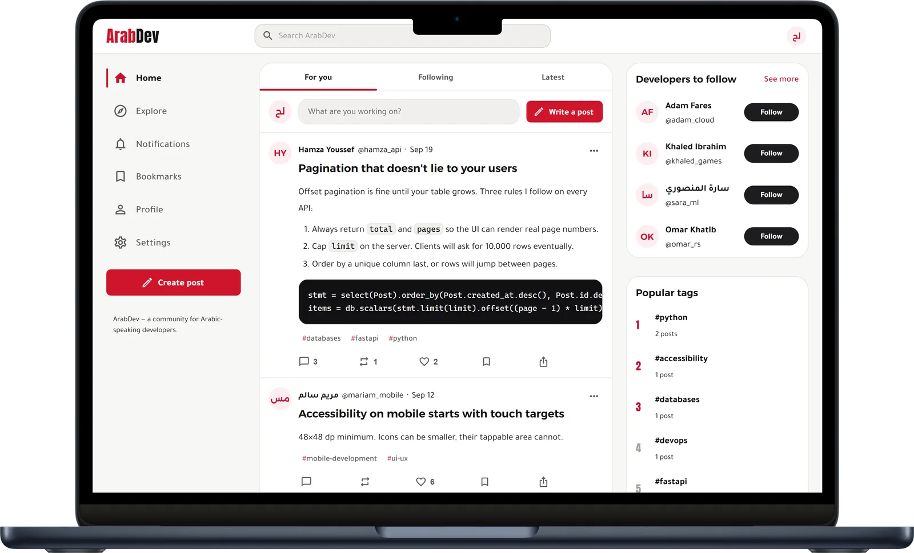

<p align="center">
  
</p>

<h1 align="center">ArabDev</h1>

<p align="center">
  A social platform for Arabic-speaking developers.<br>
  Technical posts, in Arabic and English. Free and open source.
</p>

<p align="center">
  <a href="https://arabdev.site">arabdev.site</a> ·
  <a href="https://wiki.arabdev.site">Wiki</a> ·
  <a href="https://privacy.arabdev.site">Privacy policy</a> ·
  <a href="https://patch.arabdev.site">Patch notes</a>
</p>

<p align="center">
  
</p>

---

ArabDev is where developers who speak Arabic write about their work: posts with code, tables and
images, a feed of the people and topics they follow, and discussion in the comments. The interface
is Arabic first and right to left, with a complete English version, and one post can mix both
languages because every paragraph takes its own direction.

Anyone can read without an account. Data is never sold, there are no analytics of our own, and all
of it is open source, so you can check what it does.

## Features

- **Writing.** A TipTap editor with headings, lists, quotes, tables, links, code blocks, three
  fonts, six sizes and five colours that stay readable in dark mode. Drafts, a preview, an attached
  image and link, and up to five tags per post. Markdown-style shortcuts such as `##` for a heading.
- **Feeds.** _For you_ ranks recent posts by who you follow, the interests you picked, who you
  interact with, how much discussion a post starts and how new it is, and spreads authors out.
  _Following_ and _Latest_ are newest first. Every feed has 20 posts a page and numbered pages, never
  endless scrolling. _Trending_ ranks the week by how fast posts gather reactions.
- **People.** Profiles with a bio, interests, posts, replies and saved posts; follow lists that can
  be hidden; suggestions based on interests; mentions with `@username`, with a setting for who may
  mention you; blocking, which stops all contact both ways.
- **Discovery.** Search across posts, people and tags, tag pages, popular tags, and RSS feeds for
  the whole site, every tag and every profile.
- **Notifications** for likes, comments, follows, reposts and mentions, each with its own switch, and
  emails only for things that matter to your account.
- **Moderation.** Any post can be reported with a reason. Three reports from different people hide
  it until a moderator decides to keep it, remove it, stop its author publishing for a while, or
  suspend the account. Everyone involved is emailed, and authors never learn who reported them.
- **Accounts.** Sign-in with an emailed six-digit code or an authenticator app (with ten one-time
  recovery codes), a list of signed-in devices that can be signed out one by one, alerts about
  account changes, a download of everything your account holds, and deletion that removes it.
- **Arabic and English**, switchable at any time, with correct Arabic plural forms and a fully
  mirrored layout. Light, dark and system themes, and a reduced-motion setting.
- **Readable everywhere.** Public pages arrive with their title and text already in the HTML, so
  search engines, link previews and readers without JavaScript see the real page.
- **Documentation**: a 25-article wiki, a privacy policy in 28 sections and patch notes for every
  release, all in Arabic and English, in plain HTML that GitHub Pages can serve.

## Security and privacy

- **Passwords** are hashed with Argon2id. New ones are checked against Have I Been Pwned's list of
  leaked passwords; only the first five characters of a SHA-1 hash leave the server.
- **Sessions.** The access token lives only in memory for 15 minutes. The refresh token sits in an
  `httpOnly` cookie scoped to `/api/v1/auth`, is stored hashed and rotates on every use, so a
  replayed one ends the whole session. Changing the password signs every other device out.
- **Bots.** Cloudflare Turnstile checks sign-up, sign-in, password resets, account changes,
  publishing and commenting. Everything else a signed-in account changes (likes, follows, reposts,
  reports, uploads, drafts, profile edits) needs a human pass, renewed by an invisible check every
  30 minutes (`services/human_check.py`). The sign-up form has a hidden field that only bots fill in.
- **Spam.** During its first day an account can publish 5 posts and 20 comments an hour, with at most
  2 links each and none straight to a program download or a bare IP address. The same post twice in
  a day is refused, and so are throwaway inboxes (`services/spam_guard.py`).
- **Content.** Every post is cleaned on the server with nh3 against an allow-list that mirrors the
  toolbar, and again in the browser with DOMPurify. Uploaded images are checked, size-limited and
  re-encoded to WebP, which also strips location data and anything hidden in the file.
- **Database.** Every query goes through SQLAlchemy with bound parameters, and search patterns are
  escaped. Tests send SQL injection attempts to search, sign-in, profiles and feeds.
- **Limits and headers.** Sensitive actions are rate limited per network address and per account,
  with counters shared through Redis. Pages are sent with HSTS, frame and content-type protection
  and a permissions policy; API answers and images with a policy that lets them run nothing.
- **Ads** come from Google AdSense in non-personalised mode, in fixed and labelled places
  (`features/ads/placements.tsx`). Google never receives anything about your account.
- **Search engines.** New and edited posts are announced to Bing, Yandex and the other IndexNow
  engines (`services/indexnow.py`); Google reads the sitemap. Only public addresses are sent, and
  never the profile of an account that asked not to be found.

Found a security problem? Please read [SECURITY.md](SECURITY.md) and report it privately.

## Tech stack

React 19 · TypeScript 7 · Vite 8 · MUI 9 · React Router · TanStack Query · i18next · TipTap ·
Python 3.12 · FastAPI · Pydantic 2 · SQLAlchemy 2 · Alembic · SQLite or PostgreSQL · Redis (optional)
· pytest · ruff · oxlint · Prettier

## Getting started

Requires Python 3.12 and Node.js 22.

```bash
# Backend, on http://localhost:8000 (API docs at /api/docs)
cd backend
python -m venv .venv
.venv/Scripts/activate            # macOS and Linux: source .venv/bin/activate
pip install -e ".[dev]"
cp .env.example .env              # then set SECRET_KEY
alembic upgrade head              # creates backend/arabdev.db
python -m app.cli seed --demo     # reference data, plus fictional demo accounts and posts
uvicorn app.main:app --reload --port 8000

# Frontend, on http://localhost:5173 (it passes /api and /media through to port 8000)
cd frontend
npm install
npm run dev
```

The demo accounts are fictional: `<username>@demo.arabdev.site` with the password `ArabDev2026`, for
example `layla_dev@demo.arabdev.site`. Never seed them into a real database. The dev server also
serves the documentation sites at `/wiki/`, `/privacy/` and `/patch-notes/`.

| Command                                   | What it does                                                     |
| ----------------------------------------- | ---------------------------------------------------------------- |
| `npm run dev`                             | Start the frontend development server                            |
| `npm run build`                           | Type-check, build into `frontend/dist/` and prerender the pages  |
| `npm run preview`                         | Serve the production build locally                               |
| `npm run lint`                            | Lint the frontend with oxlint                                    |
| `npm run format` / `format:check`         | Format the frontend with Prettier, or check that it is formatted |
| `pytest`                                  | Run the backend tests, each on a fresh in-memory database        |
| `ruff check .` / `ruff format .`          | Lint and format the backend                                      |
| `alembic upgrade head`                    | Apply database migrations                                        |
| `python -m app.cli seed [--demo]`         | Add the interests and house ads, and optionally demo content     |
| `python -m app.cli make-admin <username>` | Make an account a moderator                                      |
| `python -m app.cli purge-tokens`          | Delete ended sessions and old password reset links               |
| `python -m app.cli indexnow`              | Send every page in the sitemap to the IndexNow search engines    |

Run the backend commands in `backend/` and the npm commands in `frontend/`. CI runs the tests,
both linters, both format checks, the build, `pip-audit` and `npm audit` on every pull request.

**Docker.** `cp .env.example .env`, set `SECRET_KEY`, then `docker compose up --build`. The app is on
http://localhost:8080, with nginx serving the frontend and passing the API to FastAPI.

### Configuration

Backend settings come from environment variables or `backend/.env`; `backend/.env.example` lists
all of them.

| Variable                                                   | Default                          | What it does                                                                          |
| ---------------------------------------------------------- | -------------------------------- | ------------------------------------------------------------------------------------- |
| `SECRET_KEY`                                               | development value                | Signs tokens and derives keys. Required in production; changing it signs everyone out |
| `DATABASE_URL`                                             | `backend/arabdev.db`             | SQLite path, or a PostgreSQL URL                                                      |
| `REDIS_URL`                                                | unset                            | Shared rate limits and cache                                                          |
| `FRONTEND_URL`                                             | `http://localhost:5173`          | Public address used in emails, links and the sitemap                                  |
| `CORS_ORIGINS`                                             | local addresses                  | Comma-separated browser origins                                                       |
| `TRUSTED_PROXY_HOPS`                                       | `1`                              | Proxies in front of the API that append to `X-Forwarded-For`                          |
| `SMTP_HOST`, `SMTP_PORT`, `SMTP_USERNAME`, `SMTP_PASSWORD` | unset, 587                       | Outgoing mail. Without a host, emails are written to the log                          |
| `MAIL_FROM`                                                | `ArabDev <noreply@arabdev.site>` | Sender of every email                                                                 |
| `EMAIL_CODES_ENABLED`                                      | follows the mail setup           | Emailed six-digit codes; `false` switches them off if mail breaks                     |
| `TURNSTILE_SITE_KEY`, `TURNSTILE_SECRET_KEY`               | unset                            | Cloudflare Turnstile and the human pass; off unless both are set                      |
| `PWNED_PASSWORDS_ENABLED`                                  | `true`                           | The leaked-password check                                                             |
| `INDEXNOW_ENABLED`                                         | on in production                 | Announce new, edited and deleted posts to the IndexNow engines                        |
| `ADMIN_USERNAMES`                                          | unset                            | Comma-separated moderators, besides accounts with the admin flag                      |
| `MODERATION_EMAIL`                                         | the support address              | Where new reports are emailed                                                         |
| `REPORT_AUTO_HIDE_THRESHOLD`                               | 3                                | Reports from different people before a post is hidden                                 |
| `STORAGE_BACKEND`                                          | `local`                          | `database` keeps images in the database (used on Vercel)                              |
| `CRON_SECRET`                                              | unset                            | Bearer token for the daily clean-up endpoint                                          |
| `COOKIE_SECURE`                                            | `false`                          | `true` behind HTTPS (automatic on Vercel)                                             |

### Deployment

arabdev.site runs on Vercel from this repository, and pushing to `main` deploys it. The frontend is
built to static files, and `api/index.py` serves the API as a Python function in Frankfurt, next to
the Neon PostgreSQL database and Upstash Redis. Each new instance applies pending migrations under a
database lock, and a daily job deletes expired sessions, codes and old reports.

The wiki, privacy policy and patch notes are published with GitHub Pages from their own
repositories ([Wiki](https://github.com/fut0r/Wiki),
[Privacy-policy](https://github.com/fut0r/Privacy-policy),
[Patch-notes](https://github.com/fut0r/Patch-notes)). The folders here are the source, and their
pages and assets are copied there after a change.

## Project structure

```
backend/
  app/
    api/v1/       REST routes, one module per area: auth, users, posts, drafts, media, moderation…
    api/          Served from the site root: readable pages, RSS feeds, sitemap, IndexNow key
    core/         Settings, database, security, permissions, rate limiting, errors, encryption
    services/     The rules: accounts, two-step sign-in, posts, ranking, blocks, reports, spam, email…
    repositories/ Queries that more than one service needs
    models/       SQLAlchemy models (23 tables)
    schemas/      Pydantic request and response models
    utils/        HTML cleaning, validators, pagination, text helpers
  alembic/        Migrations
  tests/          pytest
frontend/
  src/
    api/          HTTP client, endpoints, query keys
    features/     One folder per feature: auth, posts, editor, comments, settings, moderation, ads…
    pages/        One component per route, loaded on demand
    layouts/      The app frame: top bar, side columns, bottom navigation on phones
    components/   Small shared pieces
    i18n/         ar.json and en.json
    theme/        Colours, type, spacing and the MUI theme
  scripts/        prerender.mjs writes the homepage, About and Contact text into the build
wiki/ privacy/ patch-notes/   The documentation sites, in Arabic and English
api/index.py      The API as a Vercel function
vercel.json       Build, routing, security headers and the daily job
```

A few rules keep it maintainable:

- Routes are thin: they parse the request, call a service and return a schema. The rules live in
  `services/`, so the API refuses anything the interface only hides.
- Every string people see is in both `ar.json` and `en.json`, with all the Arabic plural forms.
  Layout uses logical properties (`marginInlineStart`, `insetInlineEnd`), so it mirrors on its own.
- Errors carry a stable `code` that the frontend translates; a new code gets a translation in both
  languages.
- A route that changes something requires the human pass or a Turnstile check of its own, and
  anything people publish goes through `spam_guard`.
- A schema change comes with an Alembic migration that works on both SQLite and PostgreSQL, and a
  behaviour change comes with a test.
- When behaviour changes for people, the wiki, the privacy policy and the patch notes change with
  it, in both languages and with the same element ids.

## Design

A small design system on top of the MUI theme (`frontend/src/theme`): warm neutral surfaces, one red
accent (`#D0152B`, lighter in dark mode), cards with hairline borders instead of shadows, and 8 to
12 pixel corner radii. Type is Alexandria for headings, Tajawal for body text and Anton for the
wordmark. Desktop has three columns (navigation, content, a side column), tablets a narrow rail, and
phones a bottom bar. The documentation sites copy the same tokens in plain CSS (`assets/site.css`),
so the four sites look like one product.

## Credits

- Fonts: Alexandria, Tajawal and Anton, all under the SIL Open Font License 1.1, bundled in
  `frontend/public/fonts`.
- Editor: [TipTap](https://tiptap.dev) and ProseMirror. HTML cleaning:
  [nh3](https://github.com/messense/nh3) on the server and
  [DOMPurify](https://github.com/cure53/DOMPurify) in the browser.
- Passwords and keys: [argon2-cffi](https://github.com/hynek/argon2-cffi),
  [PyJWT](https://github.com/jpadilla/pyjwt),
  [cryptography](https://github.com/pyca/cryptography). QR codes for authenticator apps:
  [segno](https://github.com/heuer/segno). Images: [Pillow](https://python-pillow.org).
- Services: [Have I Been Pwned](https://haveibeenpwned.com/Passwords) for the leaked-password list,
  [Cloudflare Turnstile](https://www.cloudflare.com/products/turnstile/) for the bot check and
  [IndexNow](https://www.indexnow.org) for search engines.
- The demo accounts and posts in `backend/app/demo_data.py` are fictional and exist only for local
  development.

## Contributing

Bug fixes, translations, docs and features are all welcome. Read [CONTRIBUTING.md](CONTRIBUTING.md)
first, and follow the [code of conduct](CODE_OF_CONDUCT.md). For anything bigger than a small fix,
open an issue before you start.

## License

ArabDev is free software, released under the
[GNU General Public License v3.0](LICENSE) or later.

Developed by Zyad Mohamed · <https://github.com/fut0r/Arabdev>
